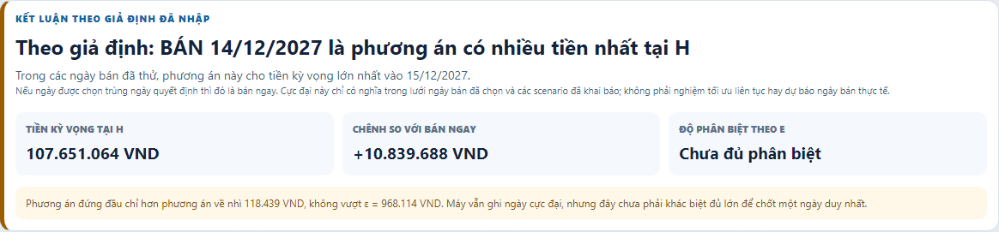
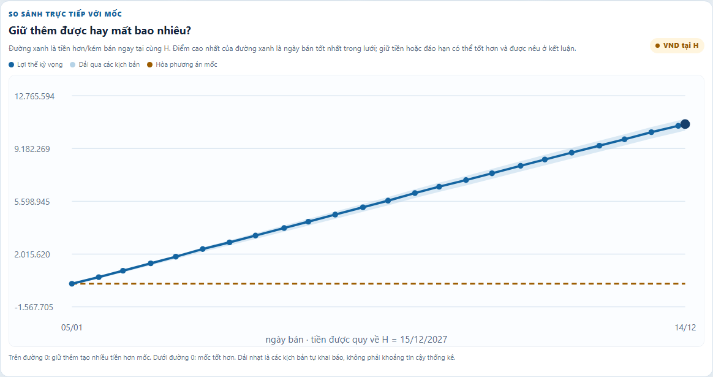

# Vietnam Government Bond Yield-Curve Research

**A local, model-only prototype** for comparing a bond sale plan with holding under declared yield-curve scenarios. The model expresses each alternative as terminal cash at a shared horizon, so the assumptions and cash-flow mechanics can be inspected together.

## What the model is deciding



*The displayed inputs and yield scenarios are illustrative assumptions. The output is the best expected result within the selected candidate-date grid; it is not a forecast or a continuous optimum.*

The holder model compares sale dates after including eligible coupons and settlement timing. Its expected result is reported alongside scenario outcomes, the cash baseline, and an ε-based near-tie check. A separate MODEL_ONLY workspace exposes the scenario interface and line-item cash ledger.

### How the comparison moves over candidate sale dates



## Research question

Given a declared curve, cash-rate scenarios, coupon schedule, quote, transaction costs and terminal horizon **H**, how do the terminal cash outcomes compare for selling now, selling later, or holding to maturity? The engine keeps the baseline, assumptions, settlement lag and evidence status visible for review.

## What is implemented

- Python calculation engine with explicit cash-flow and scenario inputs.
- Local browser workspace backed by a loopback-only API.
- Holder-plan and model-only interfaces with cash ledger, scenario comparison and declared limits.
- Synthetic study artifacts and mathematical, property-style, acceptance and local-server checks.

## Interactive side demo: when to sell, and how much?

[Open the Perfect Foresight demo](demos/perfect-foresight/ryc_perfect_foresight_demo.html) to explore a separate, deliberately simplified question: **if the future price path were known, which sale month `t*` and sale share `q*` maximize cash at a common horizon `H`?** The page shows the objective curve, a `(month, share)` heatmap, nearby alternatives and sensitivity to changed assumptions. It keeps **hold to H** as a separate comparison, so a 0% sale cannot be mislabeled as an optimal sale date.

This demo uses a future path supplied in advance. It is a teaching aid for the decision mechanics, **not** a forecast or the conclusion of the main RYC research model. [Read its assumptions and controls](demos/perfect-foresight/README.md).

## Run locally

Python 3.11 or later is required. The application uses the standard library.

```bash
python ryc_v3_local_server.py --host 127.0.0.1 --port 8772
```

Open `http://127.0.0.1:8772/ryc_holder_decision_workspace.html` for the holder workspace or `http://127.0.0.1:8772/ryc_v3_decision_workspace.html` for the model-only scenario interface. Example model input: [`examples/ryc_v3_example_model.json`](examples/ryc_v3_example_model.json).

## Repository map

- `ryc_v3_engine.py` — terminal-wealth calculation and model decision logic.
- `ryc_v3_local_server.py` — loopback-only API and static interface host.
- `ryc_holder_baseline_builder.py`, `ryc_holder_presentation.py` — holder-plan contract and display.
- `ryc_holder_decision_workspace.html` — holder interface; `ryc_v3_decision_workspace.html` — model-only interface.
- `examples/` — synthetic model inputs; `docs/` — research protocol, assumptions and status.

## Status and limits

The published examples use `MODEL_ONLY / DECLARED_SYNTHETIC` inputs. The screenshot is a reproducible interface example, not an observed bond quote. Vietnamese market conventions, including curve value date, day-count and holiday calendar, remain unresolved. No live execution, trading performance, alpha, forecast or optimal-stopping claim is established. This is a research prototype, not investment advice.
