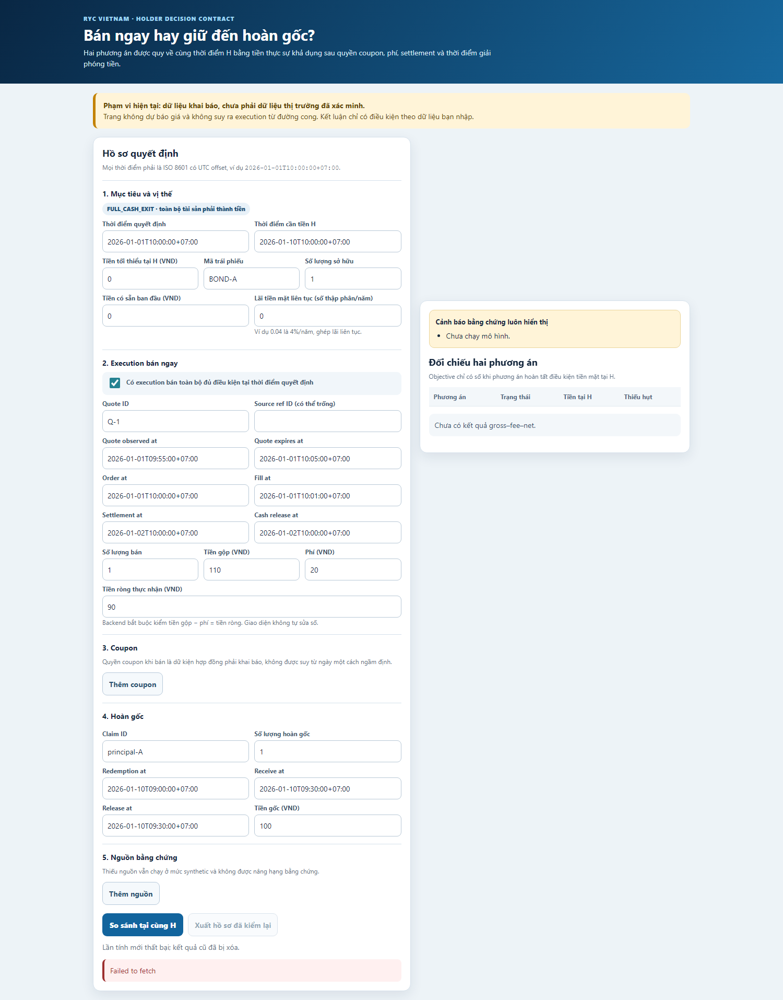

# Vietnam Government Bond Yield-Curve Research

A local research prototype for comparing a bond sale plan with holding under declared yield-curve scenarios and a shared terminal cash horizon.

## Research question

Given a declared set of yield scenarios, coupon and settlement conventions, costs, and terminal horizon H, how do the modeled terminal cash outcomes compare for a selected sale/hold plan and a hindsight reference? The engine keeps assumptions and evidence status visible so the comparison can be inspected.

## What is implemented

- A Python engine with explicit cash-flow and scenario inputs.
- A local API serving a browser workspace for loading and reviewing a holder plan.
- A separate model-only workspace for scenario comparisons.
- Mathematical, property-style, acceptance, and local-server checks.
- A synthetic study with a stored result snapshot.

## Run

Python 3.11 or later is required. The application uses the Python standard library.

    python ryc_v3_local_server.py --host 127.0.0.1 --port 8772

Open http://127.0.0.1:8772/ryc_holder_decision_workspace.html for the holder workspace or http://127.0.0.1:8772/ryc_v3_decision_workspace.html for the MODEL_ONLY scenario interface. Example model input is in examples/ryc_v3_example_model.json.

Run checks:

    python -m tests.ryc_v3_mathematical_checks
    python -m tests.ryc_v3_property_checks
    python -m tests.ryc_v3_acceptance_tests

The local-server checks require the server to be running:

    python -m tests.ryc_v3_local_server_checks

## Structure

- ryc_v3_engine.py — calculation and decision logic.
- ryc_v3_local_server.py — loopback-only API and static interface host.
- ryc_holder_baseline_builder.py and ryc_holder_presentation.py — holder-plan construction and display contract.
- ryc_holder_decision_workspace.html and JavaScript — holder interface; ryc_v3_decision_workspace.html — model-only scenario interface.
- examples/ — synthetic model input.
- tests/ — mathematical, property, acceptance, and API checks.
- docs/ — system contract, research protocol, synthetic study, and interface capture.

## Evidence status and limits

The published example is MODEL_ONLY / DECLARED_SYNTHETIC. The screenshot and sample inputs use illustrative assumptions. Vietnamese market conventions, including curve value date and day-count details, remain unresolved. No live execution, trading performance, alpha, or optimal-stopping claim is established. This is a modeling exercise, not investment advice.
