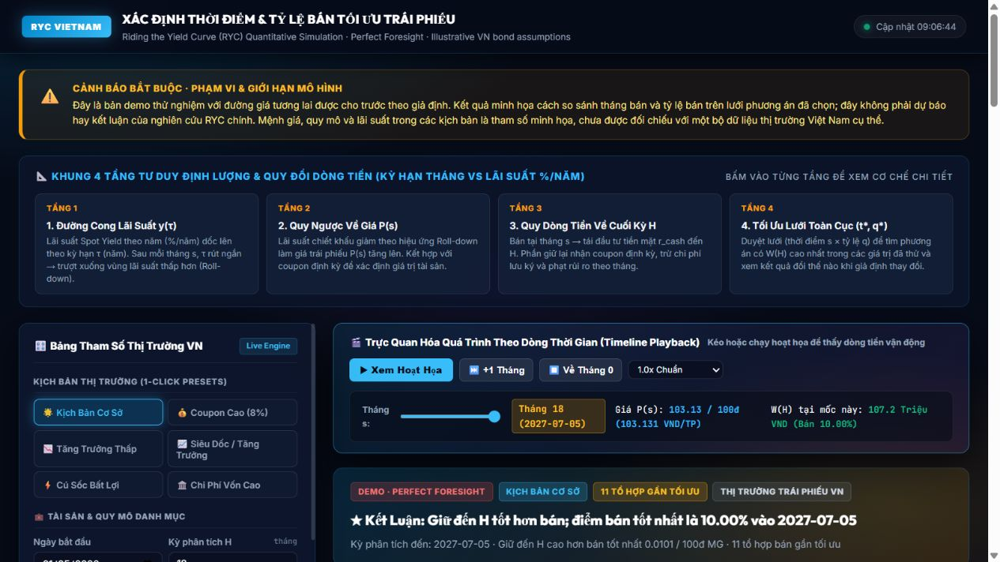

# RYC Perfect Foresight — demo quyết định bán

**Câu hỏi của demo:** nếu đã biết trước toàn bộ đường giá giả định, bán trái phiếu ở tháng nào (`t*`) và bán bao nhiêu phần trăm (`q*`) để giá trị tiền tại kỳ cuối `H` lớn nhất?

*Kịch bản cơ sở minh họa: điểm bán tốt nhất trên lưới là bán 10% ở tháng 18, nhưng giữ đến H vẫn cho W(H) cao hơn khoảng 10.107 VND trên danh mục 100 triệu VND. Vì vậy kết luận tổng thể của kịch bản là giữ, không phải bán.*

[Mở trang demo](ryc_perfect_foresight_demo.html) trực tiếp trong trình duyệt. Chọn một trong bốn kịch bản, đổi chi phí hoặc đường giá, rồi quan sát:

- Tháng bán và tỷ lệ bán được chọn trên **lưới phương án bán thật `q>0`**.
- Heatmap `(tháng, tỷ lệ)`, đường giá và giá trị mục tiêu `W(H)`; các ô gần tối ưu được đánh dấu riêng.
- Bảng so sánh bán ngay, bán sớm, bán muộn và **giữ đến H**. Phương án giữ không bị gắn một tháng bán giả.
- Biểu đồ độ nhạy và phần giải thích vì sao thay tham số làm lựa chọn đổi.

Mô hình tính tiền bán sau phí/thuế/tác động thị trường, tiền tái đầu tư, coupon, giá trị phần còn nắm giữ và chi phí/rủi ro theo giả định đã nhập. [Báo cáo kỹ thuật](RYC_PERFECT_FORESIGHT_DEMO_REPORT.md) ghi công thức và phạm vi.

**Ranh giới:** đường giá tương lai được cho sẵn theo giả định perfect foresight. Demo này minh họa cơ chế tối ưu; nó không dự báo thị trường Việt Nam, không phải kết luận của mô hình RYC chính và không đưa ra khuyến nghị giao dịch.
