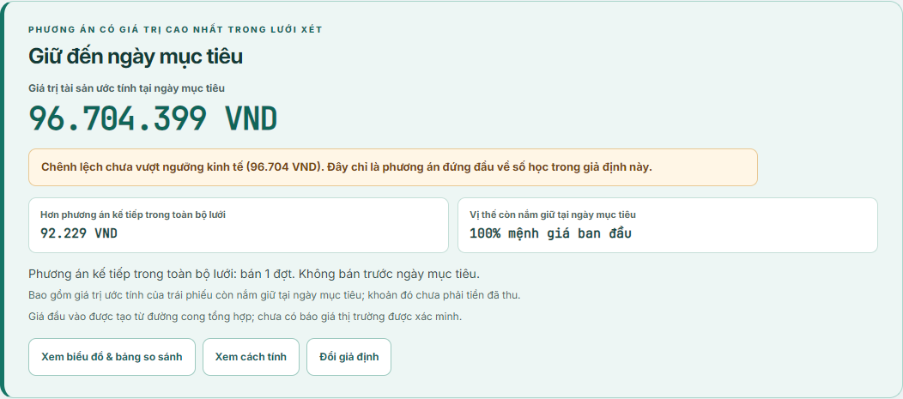
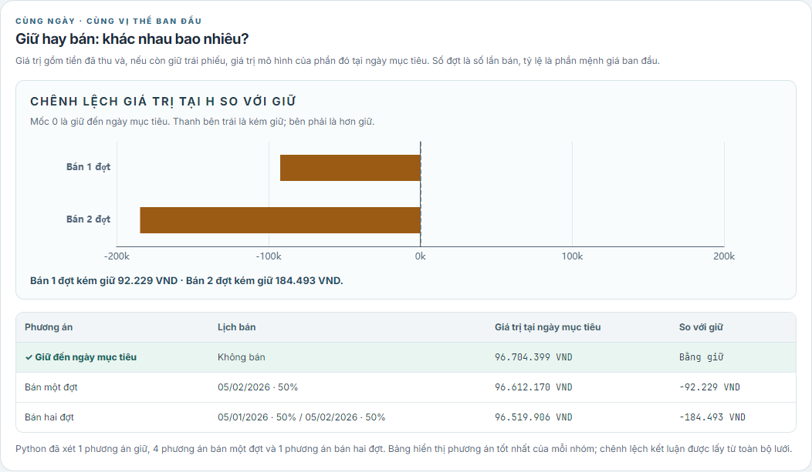
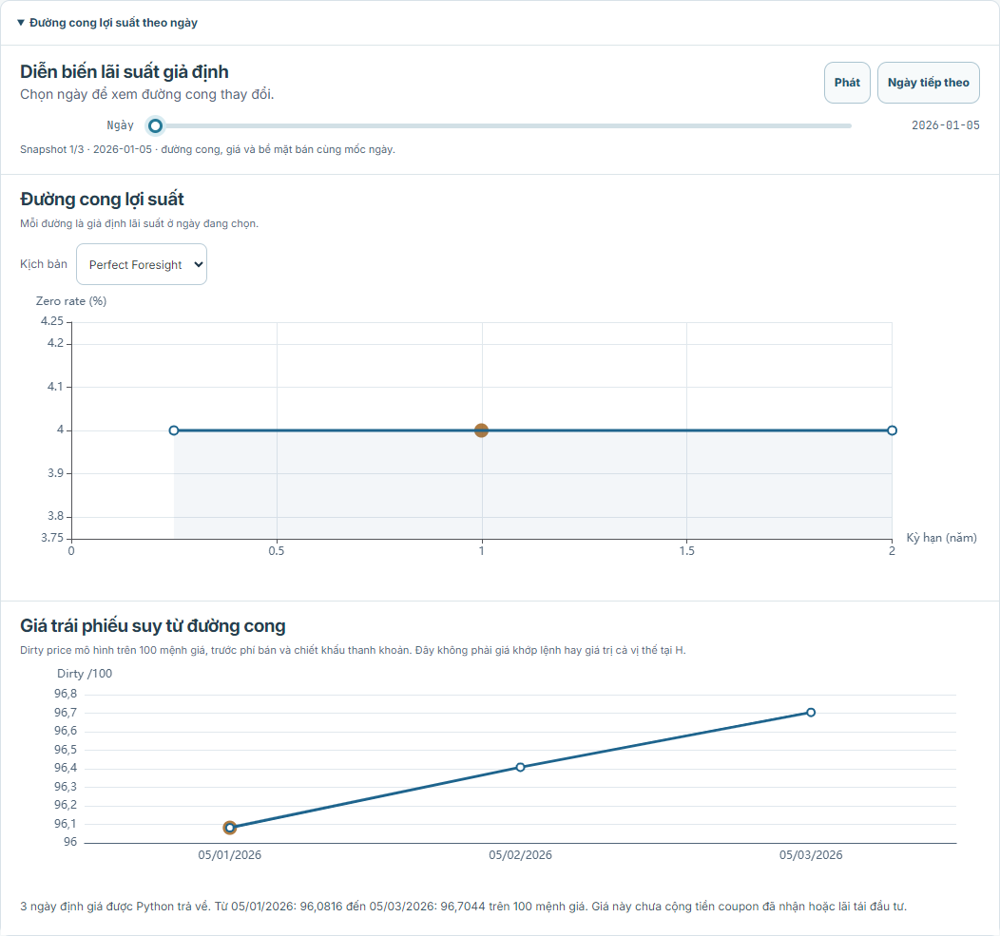

# Perfect Foresight V3 — giữ hay bán trái phiếu?

Đây là workspace phân tích quyết định mới nhất của RYC. Người xem khai báo đường cong lợi suất và các điều kiện mô hình, sau đó so sánh giữ đến ngày mục tiêu với bán một hoặc hai đợt. **Python V3 tính giá và dòng tiền; JavaScript chỉ dựng giao diện và hiển thị kết quả.**

## Kết quả mẫu cho thấy điều gì?

Trong fixture tổng hợp, giữ đến ngày mục tiêu cho giá trị mô hình **96.704.399 VND** trên vị thế 100 triệu VND. Phương án kế tiếp trong toàn bộ lưới kém **92.229 VND**, trong khi ngưỡng kinh tế khai báo là **96.704 VND**. Giao diện vì vậy phân biệt hai ý: giữ đứng đầu về số học trong giả định hiện tại, nhưng mức chênh chưa vượt ngưỡng kinh tế.



*Dữ liệu zero-coupon và đường cong đều được tạo để minh họa. Đây không phải báo giá trái phiếu thật.*

## Trong giao diện có gì?

- **Kết luận trước, giả định sau:** phương án đứng đầu, giá trị tại mục tiêu, chênh lệch so với phương án kế tiếp và phần vị thế còn giữ.
- **So sánh cùng mốc:** bảng và biểu đồ đặt giữ, bán một đợt, bán hai đợt cạnh nhau tại cùng ngày mục tiêu.
- **Xem đường cong theo ngày:** timeline nối ngày định giá với zero curve và giá dirty mô hình do Python trả về. Giá mô hình không phải giá khớp lệnh hay giá trị của toàn bộ vị thế.
- **Kiểm tra Regret:** tab thứ hai đọc kết quả mô phỏng P3-B tổng hợp; kế hoạch đã chọn không bị tối ưu lại trên đường cong dùng để đánh giá.
- **Xem cấu phần:** sổ cái tách tiền đã nhận khỏi model mark của phần trái phiếu chưa bán.





## Chạy trên máy

Cần Python 3.11 trở lên; demo dùng thư viện chuẩn của Python. Từ thư mục gốc repository, chạy:

```bash
python demos/perfect-foresight/app/ryc_v3_local_server.py --host 127.0.0.1 --port 8772
```

Mở <http://127.0.0.1:8772/ryc_perfect_foresight_workspace.html>. Nếu trang đang mở từ `file://`, nó sẽ hiện hướng dẫn chạy server cục bộ thay vì gọi API. UI, font và ECharts đều nằm trong repository; request phân tích chỉ đi tới server localhost.

## Chạy test

```bash
python demos/perfect-foresight/tests/ryc_perfect_foresight_tests.py
node demos/perfect-foresight/tests/ryc_perfect_foresight_ui_tests.cjs
```

Test Python kiểm tra định giá, coupon/settlement, lưới phương án và sổ cái. Test Node kiểm tra preset, slider/payload, timeline, trạng thái kết quả cũ và hợp đồng hiển thị.

## Cấu trúc

- `app/ryc_v3_engine.py` — nguồn tính toán Python V3.
- `app/ryc_v3_local_server.py` — server localhost cho file tĩnh, health check và API phân tích.
- `app/ryc_perfect_foresight_workspace.html` — giao diện quyết định và Regret Viewer.
- `app/ryc_perfect_foresight_workspace.js` — dựng payload, gọi API và hiển thị response; không chứa công thức định giá.
- `app/ryc_perfect_foresight_example.json` — fixture phân tích tổng hợp.
- `app/RYC_P3B_SYNTHETIC_RESULT_2026-11-16.json` — ví dụ Regret tổng hợp.
- `app/fonts/`, `app/echarts-6.1.0-*` — asset và license của font/ECharts.
- `screenshots/` — ảnh giao diện từ workspace V3.
- `tests/` — test engine và giao diện.

## Giới hạn cần đọc cùng kết quả

- **Trạng thái nghiên cứu: `MODEL_ONLY / DECLARED_SYNTHETIC`.** Fixture dùng số liệu dựng để minh họa cách engine định giá và xếp hạng phương án; chưa dùng dữ liệu thị trường Việt Nam đã xác minh.
- “Perfect Foresight” giả định biết trước đường cong lợi suất của cả kỳ; đây là điều kiện mô hình, **không phải dự báo**.
- Fixture hiện tại là dữ liệu tổng hợp. Chưa có báo giá bid/fill hay kiểm định ngoài mẫu.
- Khi ngày mục tiêu trước ngày đáo hạn, phần trái phiếu chưa bán được ghi nhận bằng model mark proxy; nó chưa phải tiền bán thu được.
- Gate value date/day-count cho đường cong HNX vẫn chưa đạt, nên ví dụ không được gọi là backtest thị trường Việt Nam.
- Chênh lệch/threshold là diagnostic theo giả định đầu vào, không phải kiểm định ý nghĩa thống kê hoặc khuyến nghị giao dịch.
